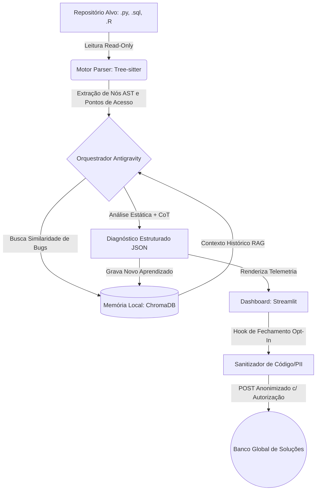

<div align="center">

# 🛡️ DataPulse AST Debugger v1.0
### *Zero-Execution Multi-Language AST Static Debugger & Local RAG Memory*
**Analisador e debugger estático não-invasivo (100% Read-Only) para Engenharia e Ciência de Dados (Python, SQL e R).**

[](https://github.com/vinodelucia/datapulse-ast-debugger/actions/workflows/ci.yml)
[](https://github.com/vinodelucia/datapulse-ast-debugger/releases/latest)
[](https://www.python.org/)
[](#)
[](#)
[](#)
[](LICENSE)

<br>

### 🔒 [**AUDITORIA ESTÁTICA 100% READ-ONLY • MEMÓRIA VETORIAL LOCAL (.datapulse_memory)**](https://github.com/vinodelucia/datapulse-ast-debugger/releases/latest)
*(Zero execução de código-fonte • Motor Híbrido Gemini + Heurística Offline / Zero code execution • Hybrid AI + Offline Heuristics)*

<br>

[**🇧🇷 Português**](#-português-pt-br) &nbsp;•&nbsp; [**🇺🇸 English**](#-english-en)

</div>

---

## 🇧🇷 Português (PT-BR)

### 🎯 Visão Geral
Ferramentas tradicionais de linting analisam apenas estilo superficial ou exigem a importação/execução de módulos — o que representa um risco de segurança ao auditar pipelines de terceiros e não captura gargalos semânticos de dados (como loops `.iterrows()` em DataFrames, `CROSS JOIN` acidental em SQL ou realocação quadrática em R).

O **DataPulse AST Debugger** foi projetado sob a filosofia **Zero-Execution & Local-First**:
1. **Leitura Binária 100% Read-Only:** O repositório alvo é lido exclusivamente como bytes brutos e convertido em *Abstract Syntax Trees* (`Tree-sitter`), sem executar ou modificar uma única linha de código.
2. **Mapeamento de Pontos de Acesso AST:** Funções, classes, queries SQL e blocos vetoriais em R recebem uma assinatura estrutural única (`SHA-256`).
3. **Memória Evolutiva com RAG Local (`ChromaDB`):** Antes de diagnosticar um bloco, o agente consulta os casos históricos na sua máquina (`.datapulse_memory/`) e contabiliza reincidências automaticamente.
4. **Inspeção Visual Lado a Lado (`Streamlit`):** Exibe KPIs, Heatmap de incidência por arquivo e o comparativo entre o código original e a refatoração sugerida.
5. **Contribuição Global Opt-In & Sanitizada:** Ao encerrar a sessão, você decide se deseja compartilhar apenas hashes matemáticos de AST com a comunidade (com auditoria transparente do JSON e remoção total de código-fonte e PII).

### ⚡ Principais Diferenciais
* **Parsing Multilinguagem Unificado (`Tree-sitter`):** Suporte nativo para `.py`, `.sql`, `.r` e `.R`, extraindo nós semânticos reais da árvore sintática com fallback determinístico via stdlib AST.
* **Motor Híbrido (Google Gemini 2.5 Pro + Heurística Estática Nativa):** Se a variável `GEMINI_API_KEY` estiver configurada, o orquestrador utiliza `gemini-2.5-pro` com *Structured Outputs* (`Pydantic`) e *Chain-of-Thought*. Caso o usuário esteja 100% offline ou sem chave de API, o sistema aciona automaticamente o **Motor Heurístico Determinístico**, garantindo funcionamento imediato (*plug-and-play*).
* **Memória Vetorial Persistente (`ChromaDB` + `SQLite`):** Embeddings locais de 384 dimensões (`all-MiniLM-L6-v2` com fallback de hash determinístico) e trilha de auditoria local em SQLite (`audit_sessions.sqlite3`).
* **Dashboard Bilíngue em Tempo Real:** Interface interativa em Streamlit e Plotly com seletor instantâneo de idioma (`🇺🇸 English` | `🇧🇷 Português`) na barra lateral.
* **Sanitizador de Privacidade e PII:** Filtro integrado que remove caminhos de diretórios locais, endereços IP e código proprietário antes de qualquer exportação Opt-In.

### 🗂️ Gramáticas e Categorias Auditadas

| Linguagem | Nós AST Mapeados | Categoria de Diagnóstico | Impacto Mitigado |
| :--- | :--- | :--- | :--- |
| **Python (`.py`)** | `function_definition`, `class_definition`, `with_statement` | `Pandas_Iterrows_Bottleneck` | Substitui iteração linha a linha por vetorização C-level em DataFrames. |
| **Python (`.py`)** | `function_definition` | `Pandas_ChainedIndexing_Warning` | Previne mutações silenciosas em cópias temporárias (`SettingWithCopyWarning`). |
| **Python (`.py`)** | `function_definition` | `SQL_Injection_Vulnerability` | Detecta interpolação direta (`f-strings`) em cursores de banco de dados. |
| **SQL (`.sql`)** | `select`, `create_table_statement`, `cte` | `SQL_FullTableScan` | Identifica `SELECT *` combinado com `CROSS JOIN` ou predicados não-indexáveis (`LIKE '%...'`). |
| **R (`.r`, `.R`)** | `function_definition`, `left_assignment`, `call` | `R_Vectorization_Missing` | Elimina crescimento iterativo de objetos (`rbind` em loop `for`) com custo $O(N^2)$ de RAM. |

### 🏛️ Arquitetura de Alto Nível



### 🛠️ Como Usar

```bash
# 1. Clone o repositório
git clone https://github.com/vinodelucia/datapulse-ast-debugger.git
cd datapulse-ast-debugger

# 2. Crie e ative um ambiente virtual
python -m venv .venv
.venv\Scripts\activate  # Linux/macOS: source .venv/bin/activate

# 3. Instale as dependências
pip install -r requirements.txt

# 4. Verifique as gramáticas AST (Python, SQL e R)
python setup_grammars.py

# 5. (Opcional) Configure sua chave Gemini — funciona 100% offline se omitida
set GEMINI_API_KEY=sua_chave_aqui

# 6. Inicie o Dashboard Interativo
streamlit run dashboard/app.py
```

### 🧪 Testes Automatizados (CI/CD Quality Gate)
O projeto conta com uma suíte de testes unitários em `pytest` que valida o parsing Read-Only nas 3 linguagens, a contagem de reincidência no ChromaDB e garante que o **Sanitizador de Privacidade** jamais vaze código-fonte ou IPs locais:
```bash
python -m pytest -v
```

---

## 🇺🇸 English (EN)

### 🎯 Overview
Traditional linters only check surface-level formatting or require importing/executing modules—which poses a security risk when auditing third-party pipelines and misses deep data engineering bottlenecks (such as `.iterrows()` loops on large DataFrames, accidental SQL `CROSS JOIN`s, or quadratic memory reallocation in R).

**DataPulse AST Debugger** is built around a strict **Zero-Execution & Local-First philosophy**:
1. **100% Read-Only Binary Scanning:** Target repositories are read strictly as raw bytes and parsed into *Abstract Syntax Trees* (`Tree-sitter`), never executing or mutating a single line of target code.
2. **Semantic AST Access Point Mapping:** Functions, classes, SQL queries/CTEs, and R vector blocks are mapped with a deterministic `SHA-256` structural signature (`ast_hash`).
3. **Evolving Local RAG Memory (`ChromaDB`):** Prior to diagnosing a code block, the agent queries your local vector store (`.datapulse_memory/`) for similar past bugs and automatically increments recurrence counters.
4. **Side-by-Side Visual Inspector (`Streamlit`):** Renders real-time KPIs, file recurrence Heatmaps, and a side-by-side comparison of the original code versus the suggested refactoring.
5. **Opt-In Anonymized Global Telemetry:** Upon closing a session, you choose whether to contribute abstract AST signatures to the community (with transparent JSON inspection and strict stripping of source code and PII).

### ⚡ Key Features
* **Unified Multi-Language AST Engine (`Tree-sitter`):** Native support for `.py`, `.sql`, `.r`, and `.R`, extracting semantic syntax nodes with a deterministic stdlib AST fallback.
* **Hybrid AI Engine (Google Gemini 2.5 Pro + Native Static Heuristics):** Automatically connects to `gemini-2.5-pro` via `google-genai` with *Structured Outputs* (`Pydantic`) and *Chain-of-Thought* when `GEMINI_API_KEY` is set. If no API key is provided or you are offline, it seamlessly falls back to a **Zero-Config Deterministic Static Engine**.
* **Persistent Vector Memory (`ChromaDB` + `SQLite`):** 384-dimensional local embeddings (`all-MiniLM-L6-v2` with deterministic hash fallback) paired with a local SQLite session audit log (`audit_sessions.sqlite3`).
* **Bilingual Reactive Dashboard:** Built with Streamlit and Plotly featuring a live sidebar toggle (`🇺🇸 English` | `🇧🇷 Português`).
* **Built-In PII & Source Code Sanitizer:** Automatically redacts local file paths, IPv4 addresses, and proprietary source code from any opt-in telemetry payload.

### 🗂️ Audited Grammars & Vulnerability Categories

| Language | Mapped AST Nodes | Diagnostic Category | Mitigated Impact |
| :--- | :--- | :--- | :--- |
| **Python (`.py`)** | `function_definition`, `class_definition`, `with_statement` | `Pandas_Iterrows_Bottleneck` | Replaces row-by-row iteration with C-level vectorized DataFrame operations. |
| **Python (`.py`)** | `function_definition` | `Pandas_ChainedIndexing_Warning` | Prevents silent mutations on temporary copies (`SettingWithCopyWarning`). |
| **Python (`.py`)** | `function_definition` | `SQL_Injection_Vulnerability` | Detects raw `f-string` / string concatenation inside database cursor calls. |
| **SQL (`.sql`)** | `select`, `create_table_statement`, `cte` | `SQL_FullTableScan` | Flags `SELECT *` combined with `CROSS JOIN` or non-sargable predicates (`LIKE '%...'`). |
| **R (`.r`, `.R`)** | `function_definition`, `left_assignment`, `call` | `R_Vectorization_Missing` | Eliminates iterative object growth (`rbind` inside `for` loops) with $O(N^2)$ RAM overhead. |

### 🛠️ Quick Start (From Source)
```bash
git clone https://github.com/vinodelucia/datapulse-ast-debugger.git
cd datapulse-ast-debugger
pip install -r requirements.txt
python setup_grammars.py
streamlit run dashboard/app.py
```

### 🧪 Automated Tests (CI/CD Quality Gate)
```bash
python -m pytest -v
```

---

## 📂 Arquitetura do Projeto / Project Structure

```text
datapulse-ast-debugger/
├── .antigravity/
│   └── agent_config.yaml        # Regras de segurança Read-Only e configuração do agente
├── .github/workflows/
│   └── ci.yml                   # Pipeline CI/CD: Pytest Quality Gate + Grammar Check + Auto Release
├── dashboard/
│   └── app.py                   # Interface Streamlit bilíngue (PT-BR / EN) com Heatmap e Modal Opt-In
├── src/
│   ├── __init__.py
│   ├── parser_engine.py         # Motor Tree-sitter Read-Only para Python, SQL e R
│   ├── memory_store.py          # Memória vetorial ChromaDB, auditoria SQLite e sanitizador PII
│   └── analyzer_agent.py        # Motor híbrido (Gemini 2.5 Pro + Fallback Heurístico Nativo)
├── tests/
│   ├── test_datapulse.py        # Testes unitários isolados de AST, RAG e privacidade (Pytest)
│   └── sample_code/             # Scripts .py, .sql e .R com bugs reais para demonstração
├── pyproject.toml               # Configuração de pacote e Pytest
├── requirements.txt             # Dependências oficiais do projeto
└── setup_grammars.py            # Verificador de gramáticas AST
```

## 📄 Licença / License
Distribuído sob a licença **MIT**. Veja o arquivo [LICENSE](LICENSE) para mais detalhes.  
Distributed under the **MIT License**. See [LICENSE](LICENSE) for more information.
