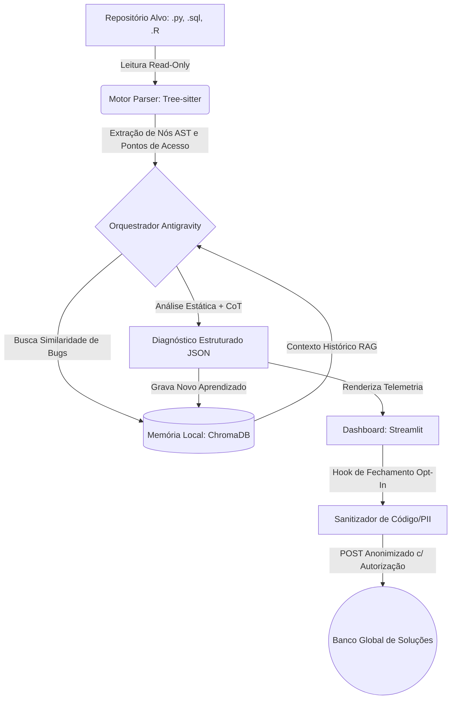

<div align="center">

# 🛡️ DataPulse AST Debugger v1.2
### *Zero-Execution Multi-Language AST Static Debugger & Local RAG Memory*
**Analisador e debugger estático não-invasivo (100% Read-Only) para Engenharia e Ciência de Dados (Python, SQL, R e JavaScript/TypeScript).**

[](https://github.com/vinodelucia/datapulse-ast-debugger/actions/workflows/ci.yml)
[](https://github.com/vinodelucia/datapulse-ast-debugger/releases/latest)
[](https://www.python.org/)
[](#)
[](#)
[](#)
[](LICENSE)

<br>

### 🔒 [**AUDITORIA ESTÁTICA 100% READ-ONLY • MEMÓRIA VETORIAL LOCAL (.datapulse_memory)**](https://github.com/vinodelucia/datapulse-ast-debugger/releases/latest)
*(Zero execução de código-fonte • Motor Híbrido Gemini + Heurística Offline / Zero code execution • Hybrid AI + Offline Heuristics)*

<br>

[**🇧🇷 Português**](#-português-pt-br) &nbsp;•&nbsp; [**🇺🇸 English**](#-english-en)

</div>

---

## 🇧🇷 Português (PT-BR)

### 🎯 Visão Geral
Linters tradicionais verificam formatação superficial ou exigem importar módulos — o que traz risco ao auditar pipelines de terceiros e deixa passar gargalos de dados (como `.iterrows()` em DataFrames, `CROSS JOIN` em SQL ou crescimento iterativo de objetos em R).

Como o **DataPulse AST Debugger** funciona:
1. **Leitura binária Read-Only:** Lê o repositório alvo como bytes brutos via `Tree-sitter`, sem executar nem modificar arquivos.
2. **Pontos de acesso AST:** Mapeia funções, queries SQL, blocos R e métodos JS/TS com uma assinatura estrutural (`SHA-256`) sem nomes nem literais.
3. **Memória local (`ChromaDB` + `SQLite`):** Grava diagnósticos em lote em `.datapulse_memory/` e aponta reincidências em novas varreduras.
4. **Dashboard (`Streamlit`):** Mostra KPIs, filtros por severidade, comparação lado a lado e exportação em Markdown/JSON.
5. **Telemetria Opt-In:** Ao fechar a sessão, você escolhe se envia apenas hashes estruturais e categorias de erro (após redação de segredos/PII e inspeção do JSON).

### ⚡ Principais Diferenciais
* **Parsing multilinguagem (`Tree-sitter`):** Suporte nativo para `.py`, `.sql`, `.r`/`.R` e `.js`, `.mjs`, `.cjs`, `.jsx`, `.ts`, `.tsx`, com fallback determinístico.
* **Análise offline por padrão + Gemini Opt-In:** Regras determinísticas rodam 100% localmente. O envio ao `gemini-2.5-pro` só ocorre com `--allow-llm` (ou checkbox no painel) e após redação de segredos/PII.
* **Memória vetorial em lote (`ChromaDB` + `SQLite`):** Embeddings locais de 384 dimensões (`all-MiniLM-L6-v2` com fallback determinístico) e trilha de auditoria local.
* **Dashboard bilíngue (`PT-BR` / `EN`):** Filtros de linguagem e severidade, paleta de alto contraste e exportação direta.
* **Sanitizador de privacidade:** Remove caminhos locais, IPs, e-mails e credenciais antes de persistir, chamar o LLM ou exportar telemetria.

### 🗂️ Gramáticas e Categorias Auditadas

| Linguagem | Nós AST Mapeados | Categoria de Diagnóstico | Impacto Mitigado |
| :--- | :--- | :--- | :--- |
| **Python (`.py`)** | `function_definition`, `class_definition`, `with_statement` | `Pandas_Iterrows_Bottleneck` | Substitui iteração linha a linha por vetorização C-level em DataFrames. |
| **Python (`.py`)** | `function_definition` | `Pandas_ChainedIndexing_Warning` | Previne mutações silenciosas em cópias temporárias (`SettingWithCopyWarning`). |
| **Python (`.py`)** | `function_definition` | `SQL_Injection_Vulnerability` | Detecta interpolação direta (`f-strings`) em cursores de banco de dados. |
| **SQL (`.sql`)** | `select`, `create_table_statement`, `cte` | `SQL_FullTableScan` | Identifica `SELECT *` combinado com `CROSS JOIN` ou predicados não-indexáveis (`LIKE '%...'`). |
| **R (`.r`, `.R`)** | `function_definition`, `left_assignment`, `call` | `R_Vectorization_Missing` | Elimina crescimento iterativo de objetos (`rbind` em loop `for`) com custo $O(N^2)$ de RAM. |
| **JavaScript/TS (`.js`, `.ts`, `.tsx`)** | `function_declaration`, `method_definition`, arrow functions | `JS_Eval_Code_Injection` / `JS_Command_Injection` | Bloqueia `eval`/`new Function` e `child_process.exec` com entrada dinâmica (inspirado em `eslint-plugin-security`). |
| **JavaScript/TS** | `function_declaration`, `method_definition` | `JS_Sync_IO_Blocking_EventLoop` | Aponta `fs.*Sync` em handlers que bloqueiam o event loop (inspirado em `eslint-plugin-n`). |
| **JavaScript/TS** | arrow functions, `method_definition` | `JS_Unhandled_Promise_Rejection` | `.then()` sem `.catch()` / `try` (inspirado em `eslint-plugin-promise`). |
| **JavaScript/TS** | funções em geral | `JS_ReDoS_Unsafe_Regex` / `JS_Hardcoded_Secret` / `SQL_Injection_Vulnerability` | Regex com quantificadores aninhados, segredos hardcoded e SQL por template literal. |

### 🏛️ Arquitetura de Alto Nível



### 🛠️ Como Usar

```bash
# 1. Clone o repositório
git clone https://github.com/vinodelucia/datapulse-ast-debugger.git
cd datapulse-ast-debugger

# 2. Crie e ative um ambiente virtual
python -m venv .venv
.venv\Scripts\activate  # Linux/macOS: source .venv/bin/activate

# 3. Instale as dependências
pip install -r requirements.txt

# 4. Verifique as gramáticas AST (Python, SQL e R)
python setup_grammars.py

# 5. (Opcional) Configure sua chave Gemini — funciona 100% offline se omitida
set GEMINI_API_KEY=sua_chave_aqui

# 6. Inicie o Dashboard Interativo
streamlit run dashboard/app.py
```

### 🧪 Testes Automatizados (CI/CD Quality Gate)
O projeto conta com uma suíte de testes unitários em `pytest` que valida o parsing Read-Only nas 3 linguagens, a contagem de reincidência no ChromaDB e garante que o **Sanitizador de Privacidade** jamais vaze código-fonte ou IPs locais:
```bash
python -m pytest -v
```

---

## 🇺🇸 English (EN)

### 🎯 Overview
Traditional linters only check surface-level formatting or require importing/executing modules—which poses a security risk when auditing third-party pipelines and misses deep data engineering bottlenecks (such as `.iterrows()` loops on large DataFrames, accidental SQL `CROSS JOIN`s, or quadratic memory reallocation in R).

**DataPulse AST Debugger** is built around a strict **Zero-Execution & Local-First philosophy**:
1. **100% Read-Only Binary Scanning:** Target repositories are read strictly as raw bytes and parsed into *Abstract Syntax Trees* (`Tree-sitter`), never executing or mutating a single line of target code.
2. **Semantic AST Access Point Mapping:** Functions, classes, SQL queries/CTEs, and R vector blocks are mapped with a deterministic `SHA-256` structural signature (`ast_hash`).
3. **Evolving Local RAG Memory (`ChromaDB`):** Prior to diagnosing a code block, the agent queries your local vector store (`.datapulse_memory/`) for similar past bugs and automatically increments recurrence counters.
4. **Side-by-Side Visual Inspector (`Streamlit`):** Renders real-time KPIs, file recurrence Heatmaps, and a side-by-side comparison of the original code versus the suggested refactoring.
5. **Opt-In Anonymized Global Telemetry:** Upon closing a session, you choose whether to contribute abstract AST signatures to the community (with transparent JSON inspection and strict stripping of source code and PII).

### ⚡ Key Features
* **Unified Multi-Language AST Engine (`Tree-sitter`):** Native support for `.py`, `.sql`, `.r`/`.R`, and **`.js`, `.mjs`, `.cjs`, `.jsx`, `.ts`, `.tsx` (new in v1.1)**, extracting semantic syntax nodes with a deterministic stdlib AST fallback.
* **Hybrid AI Engine (Google Gemini 2.5 Pro + Native Static Heuristics):** Automatically connects to `gemini-2.5-pro` via `google-genai` with *Structured Outputs* (`Pydantic`) and *Chain-of-Thought* when `GEMINI_API_KEY` is set. If no API key is provided or you are offline, it seamlessly falls back to a **Zero-Config Deterministic Static Engine**.
* **Persistent Vector Memory (`ChromaDB` + `SQLite`):** 384-dimensional local embeddings (`all-MiniLM-L6-v2` with deterministic hash fallback) paired with a local SQLite session audit log (`audit_sessions.sqlite3`).
* **Bilingual Reactive Dashboard:** Built with Streamlit and Plotly featuring a live sidebar toggle (`🇺🇸 English` | `🇧🇷 Português`).
* **Built-In PII & Source Code Sanitizer:** Automatically redacts local file paths, IPv4 addresses, and proprietary source code from any opt-in telemetry payload.

### 🗂️ Audited Grammars & Vulnerability Categories

| Language | Mapped AST Nodes | Diagnostic Category | Mitigated Impact |
| :--- | :--- | :--- | :--- |
| **Python (`.py`)** | `function_definition`, `class_definition`, `with_statement` | `Pandas_Iterrows_Bottleneck` | Replaces row-by-row iteration with C-level vectorized DataFrame operations. |
| **Python (`.py`)** | `function_definition` | `Pandas_ChainedIndexing_Warning` | Prevents silent mutations on temporary copies (`SettingWithCopyWarning`). |
| **Python (`.py`)** | `function_definition` | `SQL_Injection_Vulnerability` | Detects raw `f-string` / string concatenation inside database cursor calls. |
| **SQL (`.sql`)** | `select`, `create_table_statement`, `cte` | `SQL_FullTableScan` | Flags `SELECT *` combined with `CROSS JOIN` or non-sargable predicates (`LIKE '%...'`). |
| **R (`.r`, `.R`)** | `function_definition`, `left_assignment`, `call` | `R_Vectorization_Missing` | Eliminates iterative object growth (`rbind` inside `for` loops) with $O(N^2)$ RAM overhead. |
| **JavaScript/TS (`.js`, `.ts`, `.tsx`)** | `function_declaration`, `method_definition`, arrow functions | `JS_Eval_Code_Injection` / `JS_Command_Injection` | Flags `eval` / `new Function` and `child_process.exec` with dynamic input (inspired by `eslint-plugin-security`). |
| **JavaScript/TS** | `function_declaration`, `method_definition` | `JS_Sync_IO_Blocking_EventLoop` | Flags `fs.*Sync` inside handlers that block the event loop (inspired by `eslint-plugin-n`). |
| **JavaScript/TS** | arrow functions, `method_definition` | `JS_Unhandled_Promise_Rejection` | `.then()` without `.catch()` / `try` (inspired by `eslint-plugin-promise`). |
| **JavaScript/TS** | any function | `JS_ReDoS_Unsafe_Regex` / `JS_Hardcoded_Secret` / `SQL_Injection_Vulnerability` | Nested-quantifier regex, hardcoded secrets and SQL built via template literals. |

### 🛠️ Quick Start (From Source)
```bash
git clone https://github.com/vinodelucia/datapulse-ast-debugger.git
cd datapulse-ast-debugger
pip install -r requirements.txt
python setup_grammars.py
streamlit run dashboard/app.py
```

### 🧪 Automated Tests (CI/CD Quality Gate)
```bash
python -m pytest -v
```

---

## 🔒 Privacidade & Qualidade das Regras / Privacy & Rule Quality

* **PT:** Nada sai da sua máquina por padrão. O envio de código ao Gemini exige opt-in explícito (`--allow-llm` ou `DATAPULSE_ALLOW_LLM=1`) e o trecho é enviado com segredos/PII redigidos. Segredos também são redigidos antes de serem gravados em `.datapulse_memory`. O `ast_hash` é uma assinatura **estrutural** (apenas tipos de nós, sem nomes nem literais). Regras rodam sem casar em comentários, a de maior severidade vence, e `datapulse: ignore` dentro do trecho suprime os achados daquele ponto.
* **EN:** Nothing leaves your machine by default. Sending code to Gemini requires explicit opt-in (`--allow-llm` or `DATAPULSE_ALLOW_LLM=1`) and the snippet is sent with secrets/PII redacted. Secrets are also redacted before being written to `.datapulse_memory`. `ast_hash` is a **structural** signature (node types only, no names or literals). Rules ignore comments, the highest severity wins, and a `datapulse: ignore` marker inside a snippet suppresses its findings.

---
## 📂 Arquitetura do Projeto / Project Structure

```text
datapulse-ast-debugger/
├── .antigravity/agent_config.yaml   # Regras de segurança Read-Only
├── .github/workflows/ci.yml         # Pipeline CI/CD (Python 3.11 & 3.12 + Releases)
├── docs/
│   ├── architecture-diagram.html    # Diagrama editorial HTML/SVG da arquitetura
│   └── adr/                         # Architecture Decision Records
├── dashboard/app.py                 # Interface Streamlit bilíngue (PT-BR / EN)
├── src/
│   ├── parser_engine.py             # Motor Tree-sitter Read-Only (Py, SQL, R, JS/TS)
│   ├── rules.py                     # Regras estáticas offline (maior severidade vence)
│   ├── privacy.py                   # Redação de PII, caminhos e segredos
│   ├── memory_store.py              # ChromaDB em lote, auditoria SQLite e telemetria
│   └── analyzer_agent.py            # Orquestrador RAG + Gemini Opt-In
├── tests/                           # Suíte Pytest (22 testes) + amostras
├── cli_audit.py                     # CLI Read-Only para integração com agentes
├── GLOSSARY.md                      # Glossário canônico de domínio
├── DESIGN.md                        # Tokens visuais e diretrizes de acessibilidade
└── setup_grammars.py                # Verificador de gramáticas AST
```

## 📄 Licença / License
Distribuído sob a licença **MIT**. Veja o arquivo [LICENSE](LICENSE) para mais detalhes.  
Distributed under the **MIT License**. See [LICENSE](LICENSE) for more information.
