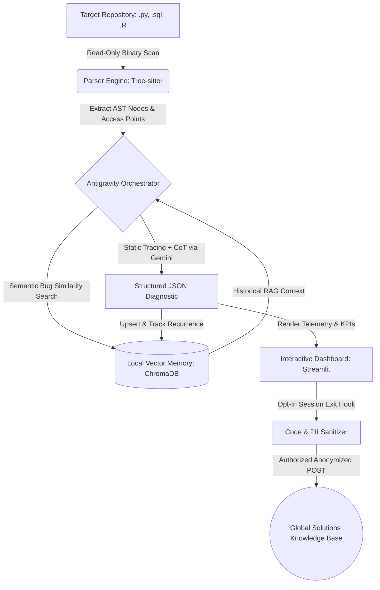
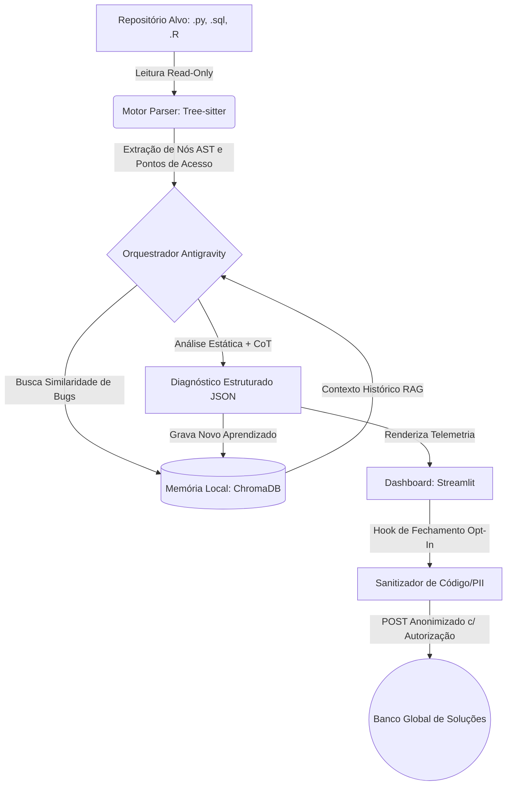

# 🛡️ DataPulse AST Debugger

<p align="center">
  <a href="#-english-documentation"></a>
  <a href="#-documentação-em-português"></a>
  <a href="README.pt-BR.md"></a>
</p>

<p align="center">
  
  
  
  
  
  
</p>

---

## 🇺🇸 English Documentation

An intelligent, non-invasive (**100% Read-Only / Zero-Execution**) static code analyzer and debugger purpose-built for **Data Engineering and Data Science (Python, SQL, and R)**.

**DataPulse AST Debugger** parses source files into **Abstract Syntax Trees (AST)** via `Tree-sitter` to map semantic access points (functions, classes, SQL CTEs/queries, and R vector blocks), diagnoses logical vulnerabilities and performance bottlenecks using **LLM + Local RAG (ChromaDB)**, builds an evolving local memory of recurring bugs on your machine, and renders interactive telemetry in a **Streamlit** dashboard with an **opt-in anonymized global contribution** workflow.

### 🏛️ High-Level Architecture



### ✨ Key Architectural Highlights

1. **Multi-Language AST Parsing (`Tree-sitter`):** Instead of splitting code into arbitrary text chunks, DataPulse extracts semantic AST nodes across Python, SQL, and R—computing a deterministic SHA-256 structural signature (`ast_hash`) for every block.
2. **Non-Invasive Security (`100% Read-Only`):** Target repositories are read strictly as raw bytes and never imported, evaluated, or mutated. Safe for auditing untrusted or third-party data pipelines.
3. **Evolving Local Vector Memory (`ChromaDB` + `SQLite`):** Every diagnostic is persisted locally in `.datapulse_memory/`. Using `sentence-transformers` (`all-MiniLM-L6-v2`), the agent retrieves the top-$k$ most similar past bugs before calling the LLM and tracks recurrence counts across scans.
4. **Privacy-First Opt-In Telemetry:** When closing a session, users can optionally share abstract bug signatures with the community. A built-in PII & source-code sanitizer strips all proprietary code, variable names, file paths, and IPs—transmitting only the mathematical AST hash and abstract error category after transparent JSON inspection and explicit user approval.

### 🛠️ Tech Stack

| Layer | Technology |
| :--- | :--- |
| **AST Parsing** | `tree-sitter`, `tree-sitter-languages` (Python, SQL, R) + deterministic AST fallback |
| **AI & LLM Orchestration** | Google Antigravity, `google-genai` SDK (`gemini-2.5-pro`), Structured Outputs (`Pydantic`) |
| **Local Vector DB & RAG** | `chromadb` (Persistent Local Client), `sentence-transformers` (`all-MiniLM-L6-v2`), `sqlite3` audit logs |
| **Frontend & Visualization** | `streamlit` (Bilingual UI: EN / PT-BR), `plotly`, `pandas` |
| **Testing & CI/CD** | `pytest`, GitHub Actions (Python 3.11 & 3.12 matrix) |

### 🚀 Quick Start

```bash
# 1. Clone the repository
git clone https://github.com/vinodelucia/datapulse-ast-debugger.git
cd datapulse-ast-debugger

# 2. Create a virtual environment and install dependencies
python -m venv .venv
source .venv/bin/activate  # On Windows: .venv\Scripts\activate
pip install -r requirements.txt

# 3. Verify AST grammars
python setup_grammars.py

# 4. (Optional) Set your Gemini API key — works offline with deterministic static heuristics if omitted
export GEMINI_API_KEY="your_api_key_here"  # PowerShell: $env:GEMINI_API_KEY="your_api_key_here"

# 5. Launch the Interactive Dashboard (Supports English & Portuguese in the sidebar!)
streamlit run dashboard/app.py
```

### 🧪 Running Automated Tests

```bash
pytest -v
```

### 📂 Project Structure

```text
datapulse-ast-debugger/
├── .antigravity/
│   └── agent_config.yaml        # Antigravity agent rules & security policy
├── .github/workflows/
│   └── ci.yml                   # GitHub Actions CI pipeline (Python 3.11 & 3.12)
├── src/
│   ├── __init__.py
│   ├── parser_engine.py         # Read-Only Tree-sitter AST engine for Python, SQL & R
│   ├── memory_store.py          # Local ChromaDB RAG store, SQLite audit log & PII sanitizer
│   └── analyzer_agent.py        # Gemini 2.5 Pro + RAG static analyzer with offline fallback
├── dashboard/
│   └── app.py                   # Bilingual (EN/PT-BR) Streamlit dashboard & Opt-In modal
├── tests/
│   ├── test_datapulse.py        # Unit & privacy sanitization test suite
│   └── sample_code/             # Sample .py, .sql, and .R scripts with real data bugs
├── pyproject.toml
├── requirements.txt
├── setup_grammars.py
├── README.md                    # Bilingual documentation (EN + PT-BR)
└── README.pt-BR.md              # Dedicated Portuguese documentation
```

---

## 🇧🇷 Documentação em Português

Um debugger estático e analisador inteligente de código voltado para **Ciência e Engenharia de Dados (Python, SQL e R)**. Construído com foco em **segurança absoluta (Zero-Execution / Read-Only)**, o DataPulse utiliza *Abstract Syntax Trees* (AST) para mapear pontos de acesso semânticos no código e constrói uma **memória vetorial local** de diagnósticos que evolui conforme você desenvolve.

### 🏛️ Arquitetura de Alto Nível



### ✨ Diferenciais de Arquitetura

1. **Parsing Multilinguagem via AST (`Tree-sitter`):** Em vez de quebrar arquivos de código em blocos arbitrários de texto, mapeamos funções, CTEs em SQL e blocos vetoriais em R diretamente na árvore sintática.
2. **Segurança Não-Invasiva (100% Read-Only):** Nenhuma linha do código auditado é executada ou alterada automaticamente. Ideal para auditar repositórios de terceiros sem riscos de segurança.
3. **Memória Vetorial Evolutiva (`ChromaDB`):** Os diagnósticos ficam salvos localmente em `.datapulse_memory/`. O agente lembra quais funções dão mais problemas no seu projeto e aponta reincidências.
4. **Privacidade First com Contribuição Global Opt-In:** Ao fechar o relatório no dashboard, o usuário pode escolher contribuir com o banco global de soluções. Um sanitizador remove todo o código-fonte e envia apenas a assinatura matemática da AST e a categoria do erro — e somente após inspeção visual e clique de autorização.

### 🚀 Como Executar Localmente

```bash
# 1. Clone o repositório
git clone https://github.com/vinodelucia/datapulse-ast-debugger.git
cd datapulse-ast-debugger

# 2. Crie o ambiente virtual e instale as dependências
python -m venv .venv
source .venv/bin/activate  # No Windows: .venv\Scripts\activate
pip install -r requirements.txt

# 3. Configure sua chave de API para o Agente Analisador (Opcional - possui fallback estático offline)
export GEMINI_API_KEY="sua_chave_aqui"

# 4. Inicie o Dashboard Interativo (com seletor de idioma EN / PT-BR na barra lateral)
streamlit run dashboard/app.py
```

---

## 📄 License / Licença

Distributed under the **MIT License**. See [`LICENSE`](LICENSE) for more information.
