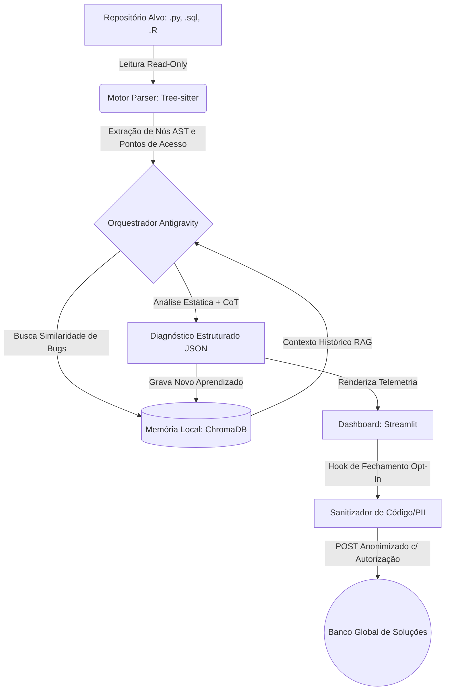

<div align="center">

# 🛡️ DataPulse AST Debugger v2.1
### *Zero-Execution Multi-Language AST Static Debugger, SQLGlot & SARIF 2.1.0*
**Analisador e debugger estático não-invasivo (100% Read-Only) para Engenharia e Ciência de Dados (Python, SQL, R e JavaScript/TypeScript).**

[](https://github.com/vinodelucia/datapulse-ast-debugger/actions/workflows/ci.yml)
[](https://github.com/vinodelucia/datapulse-ast-debugger/releases/latest)
[](https://www.python.org/)
[](#)
[](#)
[](#)
[](#)
[](LICENSE)

<br>

### 🔒 [**AUDITORIA ESTÁTICA 100% READ-ONLY • MEMÓRIA VETORIAL LOCAL (.datapulse_memory)**](https://github.com/vinodelucia/datapulse-ast-debugger/releases/latest)
*(Zero execução de código-fonte • Motor Híbrido Gemini + Heurística Offline / Zero code execution • Hybrid AI + Offline Heuristics)*

<br>

[**🇧🇷 Português**](#-português-pt-br) &nbsp;•&nbsp; [**🇺🇸 English**](#-english-en)

</div>

---

## 🇧🇷 Português (PT-BR)

### 🎯 Visão Geral
Linters tradicionais verificam formatação superficial ou exigem importar módulos — o que traz risco ao auditar pipelines de terceiros e deixa passar gargalos de dados (como `.iterrows()` em DataFrames, `CROSS JOIN` em SQL ou crescimento iterativo de objetos em R).

Como o **DataPulse AST Debugger** funciona:
1. **Leitura binária Read-Only:** Lê o repositório alvo como bytes brutos via `Tree-sitter`, sem executar nem modificar arquivos.
2. **Pontos de acesso AST:** Mapeia funções, queries SQL, blocos R e métodos JS/TS com uma assinatura estrutural (`SHA-256`) sem nomes nem literais.
3. **Memória local (`ChromaDB` + `SQLite`):** Grava diagnósticos em lote em `.datapulse_memory/` e aponta reincidências em novas varreduras.
4. **Dashboard (`Streamlit`):** Mostra KPIs, filtros por severidade, comparação lado a lado e exportação em Markdown/JSON.
5. **Telemetria Opt-In:** Ao fechar a sessão, você escolhe se envia apenas hashes estruturais e categorias de erro (após redação de segredos/PII e inspeção do JSON).

### ⚡ Principais Diferenciais
* **Motor AST Real (`Tree-sitter` + `SQLGlot` + `ast`):** Suporte nativo para Python (Pandas, PySpark, Polars, Ruff `PD`/`S`), SQL em **30+ dialetos** via `SQLGlot` (Postgres, BigQuery, Snowflake, DuckDB, Spark, T-SQL), R (`lintr`) e JS/TS (`eslint-plugin-security`/`n`/`promise`, Semgrep).
* **Multi-Achado & Complexidade Ciclomática:** Reporta todos os problemas distintos de cada função/query, calcula complexidade ciclomática (`CC`) e gera um **Health Score (0–100 / A–F)**.
* **SARIF 2.1.0 & Quality Gate CI:** Exportação nativa `--format sarif` compatível com GitHub Code Scanning (`upload-sarif`), `--fail-on` e modo `--incremental` (cache SHA-256 em SQLite).
* **Configuração por Projeto (`.datapulse.yml` / `pyproject.toml`):** Suporte a `ignore_paths`, `disable_rules`, `min_severity`, `complexity_threshold` e `sql_dialect`.
* **Sanitizador + Leak-Guard (28+ padrões):** Redige tokens (AWS, GCP/Google, GitHub, OpenAI, Anthropic, HuggingFace, Slack, Stripe, npm/PyPI, chaves privadas, Basic Auth) antes de persistir/enviar e inclui workflow `leak-guard.yml`.
* **Novas Regras SSRF / SSTI / XXE:** Detecta SSRF (`requests`/`urllib`), SSTI (`jinja2`/`ejs`/`pug`) e XML inseguro sem `defusedxml`, além de gate de triagem no prompt LLM.

### 🗂️ Gramáticas e Categorias Auditadas

| Linguagem | Nós AST Mapeados | Categoria de Diagnóstico | Impacto Mitigado |
| :--- | :--- | :--- | :--- |
| **Python (`.py`)** | `function_definition`, `ast` | `PySpark_Collect_Driver_OOM`, `Polars_Row_Iteration_Bottleneck`, `Python_Eval_Exec_Injection`, `Python_Insecure_Deserialization` | Evita OOM no driver Spark, quebra de vetorização no Polars e execução/desserialização insegura. |
| **SQL (`.sql`)** | `SQLGlot` AST (30+ dialetos) | `SQL_Mutation_Without_Where`, `SQL_Cartesian_Join_Missing_On`, `SQL_NotIn_Subquery`, `SQL_Distinct_With_Join`, `SQL_Union_Without_All` | Previne `UPDATE`/`DELETE` sem `WHERE`, joins cartesianos, armadilhas de `NULL` e sorts caros. |
| **R (`.r`, `.R`)** | `Tree-sitter` AST (`function_definition`, `for`, `call`) | `R_Vectorization_Missing`, `R_T_F_Symbol_Usage`, `R_Attach_Namespace_Pollution`, `R_Sapply_Type_Unsafe` | Elimina crescimento $O(N^2)$ em loops, uso inseguro de `T`/`F`, `attach()` e `sapply()`. |
| **JavaScript/TS (`.js`, `.ts`, `.tsx`)** | `Tree-sitter` AST (`function_declaration`, `method_definition`, arrow functions) | `JS_Prototype_Pollution`, `JS_SSRF_Dynamic_Fetch`, `JS_Await_In_Loop`, `JS_Unsafe_JSON_Parse`, `JS_Eval_Code_Injection` | Bloqueia prototype pollution, SSRF, `eval`/`exec`, `await` em loop e `JSON.parse` sem `try`. |

### 🏛️ Arquitetura de Alto Nível



### 🛠️ Como Usar

```bash
# 1. Clone o repositório
git clone https://github.com/vinodelucia/datapulse-ast-debugger.git
cd datapulse-ast-debugger

# 2. Crie e ative um ambiente virtual
python -m venv .venv
.venv\Scripts\activate  # Linux/macOS: source .venv/bin/activate

# 3. Instale as dependências
pip install -r requirements.txt

# 4. Verifique as gramáticas AST (Python, SQL e R)
python setup_grammars.py

# 5. (Opcional) Configure sua chave Gemini — funciona 100% offline se omitida
set GEMINI_API_KEY=sua_chave_aqui

# 6. Inicie o Dashboard Interativo
streamlit run dashboard/app.py
```

### 🧪 Testes Automatizados (CI/CD Quality Gate)
O projeto conta com uma suíte de testes unitários em `pytest` que valida o parsing Read-Only nas 3 linguagens, a contagem de reincidência no ChromaDB e garante que o **Sanitizador de Privacidade** jamais vaze código-fonte ou IPs locais:
```bash
python -m pytest -v
```

---

## 🇺🇸 English (EN)

### 🎯 Overview
Traditional linters only check surface-level formatting or require importing/executing modules—which poses a security risk when auditing third-party pipelines and misses deep data engineering bottlenecks (such as `.iterrows()` loops on large DataFrames, accidental SQL `CROSS JOIN`s, or quadratic memory reallocation in R).

**DataPulse AST Debugger** is built around a strict **Zero-Execution & Local-First philosophy**:
1. **100% Read-Only Binary Scanning:** Target repositories are read strictly as raw bytes and parsed into *Abstract Syntax Trees* (`Tree-sitter`), never executing or mutating a single line of target code.
2. **Semantic AST Access Point Mapping:** Functions, classes, SQL queries/CTEs, and R vector blocks are mapped with a deterministic `SHA-256` structural signature (`ast_hash`).
3. **Evolving Local RAG Memory (`ChromaDB`):** Prior to diagnosing a code block, the agent queries your local vector store (`.datapulse_memory/`) for similar past bugs and automatically increments recurrence counters.
4. **Side-by-Side Visual Inspector (`Streamlit`):** Renders real-time KPIs, file recurrence Heatmaps, and a side-by-side comparison of the original code versus the suggested refactoring.
5. **Opt-In Anonymized Global Telemetry:** Upon closing a session, you choose whether to contribute abstract AST signatures to the community (with transparent JSON inspection and strict stripping of source code and PII).

### ⚡ Key Features
* **True AST Engine (`Tree-sitter` + `SQLGlot` + `ast`):** Native rules for Python (Pandas, PySpark, Polars, Ruff `PD`/`S`), **30+ SQL dialects** via `SQLGlot` (Postgres, BigQuery, Snowflake, DuckDB, Spark, T-SQL), R (`lintr`), and JS/TS (`eslint-plugin-security`/`n`/`promise`, Semgrep).
* **Multi-Finding & Cyclomatic Complexity:** Surfaces every distinct issue per Access Point, computes cyclomatic complexity (`CC`), and outputs a **Health Score (0–100 / A–F)**.
* **SARIF 2.1.0 & CI Quality Gates:** Native `--format sarif` export for GitHub Code Scanning (`upload-sarif`), `--fail-on` severity gates, and `--incremental` SQLite SHA-256 caching.
* **Per-Project Config (`.datapulse.yml` / `pyproject.toml`):** Supports `ignore_paths`, `disable_rules`, `min_severity`, `complexity_threshold`, and `sql_dialect`.
* **Secret Sanitizer + Leak-Guard (28+ patterns):** Redacts provider tokens (AWS, GCP/Google, GitHub, OpenAI, Anthropic, HuggingFace, Slack, Stripe, npm/PyPI, private keys, Basic Auth) before storage/LLM calls and enforces `leak-guard.yml` in CI.
* **SSRF / SSTI / XXE AST Rules:** Detects Python SSRF (`requests`/`urllib`), SSTI (`jinja2`/`ejs`/`pug`), and unsafe XML parsing without `defusedxml`, paired with triage validation in the LLM prompt.

### 🗂️ Audited Grammars & Vulnerability Categories

| Language | AST Engine | Diagnostic Categories | Mitigated Impact |
| :--- | :--- | :--- | :--- |
| **Python (`.py`)** | `stdlib ast` | `PySpark_Collect_Driver_OOM`, `Polars_Row_Iteration_Bottleneck`, `Python_Eval_Exec_Injection`, `Python_Insecure_Deserialization` | Prevents Spark driver OOMs, Polars vectorization loss, and unsafe execution/deserialization. |
| **SQL (`.sql`)** | `SQLGlot` AST (30+ dialects) | `SQL_Mutation_Without_Where`, `SQL_Cartesian_Join_Missing_On`, `SQL_NotIn_Subquery`, `SQL_Distinct_With_Join`, `SQL_Union_Without_All` | Catches unguarded `UPDATE`/`DELETE`, missing `JOIN ON`, `NULL` traps, and costly sorts. |
| **R (`.r`, `.R`)** | `Tree-sitter` AST | `R_Vectorization_Missing`, `R_T_F_Symbol_Usage`, `R_Attach_Namespace_Pollution`, `R_Sapply_Type_Unsafe` | Eliminates $O(N^2)$ loop growth, mutable `T`/`F` symbols, `attach()`, and `sapply()`. |
| **JavaScript/TS (`.js`, `.ts`, `.tsx`)** | `Tree-sitter` AST | `JS_Prototype_Pollution`, `JS_SSRF_Dynamic_Fetch`, `JS_Await_In_Loop`, `JS_Unsafe_JSON_Parse`, `JS_Eval_Code_Injection` | Flags prototype pollution, SSRF, `eval`/`exec`, `await` in loops, and unguarded `JSON.parse`. |

### 🛠️ Quick Start (From Source)
```bash
git clone https://github.com/vinodelucia/datapulse-ast-debugger.git
cd datapulse-ast-debugger
pip install -r requirements.txt
python setup_grammars.py
streamlit run dashboard/app.py
```

### 🧪 Automated Tests (CI/CD Quality Gate)
```bash
python -m pytest -v
```

---

## 🔒 Privacidade & Qualidade das Regras / Privacy & Rule Quality

* **PT:** Nada sai da sua máquina por padrão. O envio de código ao Gemini exige opt-in explícito (`--allow-llm` ou `DATAPULSE_ALLOW_LLM=1`) e o trecho é enviado com segredos/PII redigidos. Segredos também são redigidos antes de serem gravados em `.datapulse_memory`. O `ast_hash` é uma assinatura **estrutural** (apenas tipos de nós, sem nomes nem literais). Regras rodam sem casar em comentários, a de maior severidade vence, e `datapulse: ignore` dentro do trecho suprime os achados daquele ponto.
* **EN:** Nothing leaves your machine by default. Sending code to Gemini requires explicit opt-in (`--allow-llm` or `DATAPULSE_ALLOW_LLM=1`) and the snippet is sent with secrets/PII redacted. Secrets are also redacted before being written to `.datapulse_memory`. `ast_hash` is a **structural** signature (node types only, no names or literals). Rules ignore comments, the highest severity wins, and a `datapulse: ignore` marker inside a snippet suppresses its findings.

---
## 📂 Arquitetura do Projeto / Project Structure

```text
datapulse-ast-debugger/
├── .antigravity/agent_config.yaml   # Regras de segurança Read-Only
├── .github/workflows/ci.yml         # Pipeline CI/CD (Python 3.11 & 3.12 + Releases)
├── docs/
│   ├── architecture-diagram.html    # Diagrama editorial HTML/SVG da arquitetura
│   └── adr/                         # Architecture Decision Records
├── dashboard/app.py                 # Interface Streamlit bilíngue (PT-BR / EN)
├── src/
│   ├── parser_engine.py             # Motor Tree-sitter + SQLGlot (Py, SQL, R, JS/TS) + CC
│   ├── config.py                    # Loader de .datapulse.yml e [tool.datapulse]
│   ├── ast_rules.py                 # Detectores AST (stdlib ast, SQLGlot, Tree-sitter)
│   ├── rules.py                     # Catálogo multi-achado + fallback linear O(N)
│   ├── sarif_exporter.py            # Exportador SARIF 2.1.0 (GitHub Code Scanning)
│   ├── privacy.py                   # Redação de PII, caminhos e segredos
│   ├── memory_store.py              # ChromaDB em lote, cache incremental SQLite e telemetria
│   └── analyzer_agent.py            # Orquestrador RAG + Health Score + Gemini Opt-In
├── tests/                           # Suíte Pytest (30 testes) + amostras
├── cli_audit.py                     # CLI Read-Only para integração com agentes
├── GLOSSARY.md                      # Glossário canônico de domínio
├── DESIGN.md                        # Tokens visuais e diretrizes de acessibilidade
└── setup_grammars.py                # Verificador de gramáticas AST
```

## 📄 Licença / License
Distribuído sob a licença **MIT**. Veja o arquivo [LICENSE](LICENSE) para mais detalhes.  
Distributed under the **MIT License**. See [LICENSE](LICENSE) for more information.
