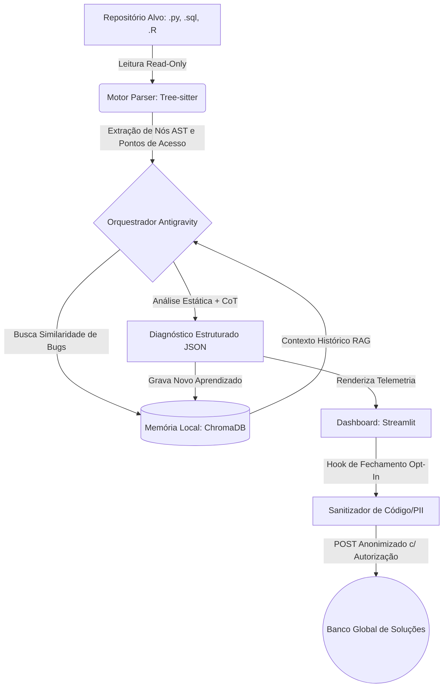

# 🛡️ DataPulse AST Debugger (Português 🇧🇷)

> 🇺🇸 **[Click here for the English Documentation](README.md)**


Um debugger estático e testador inteligente de código voltado para **Ciência e Engenharia de Dados (Python, SQL e R)**. Construído com foco em **segurança absoluta (Zero-Execution / Read-Only)**, o DataPulse utiliza *Abstract Syntax Trees* (AST) para criar pontos de acesso semânticos no código e constrói uma **memória vetorial local** de diagnósticos que evolui conforme você desenvolve.

---

## 🏛️ Arquitetura de Alto Nível



---

## ✨ Diferenciais de Arquitetura

1. **Parsing Multilinguagem via AST (`Tree-sitter`):** Em vez de quebrar arquivos de código em blocos arbitrários de texto, mapeamos funções, CTEs em SQL e blocos vetoriais em R diretamente na árvore sintática.
2. **Segurança Não-Invasiva (100% Read-Only):** Nenhuma linha do código auditado é executada ou alterada automaticamente. Ideal para auditar repositórios de terceiros sem riscos de segurança.
3. **Memória Vetorial Evolutiva (`ChromaDB`):** Os diagnósticos ficam salvos localmente em `.datapulse_memory/`. O agente lembra quais funções dão mais problemas no seu projeto e aponta reincidências.
4. **Privacidade First com Contribuição Global Opt-In:** Ao fechar o relatório no dashboard, o usuário pode escolher contribuir com o banco global de soluções. Um sanitizador remove todo o código-fonte e envia apenas a assinatura matemática da AST e a categoria do erro — e somente após inspeção visual e clique de autorização.

---

## 🚀 Como Executar Localmente

```bash
# 1. Clone o repositório
git clone https://github.com/vinodelucia/datapulse-ast-debugger.git
cd datapulse-ast-debugger

# 2. Crie o ambiente virtual e instale as dependências
python -m venv .venv
source .venv/bin/activate  # No Windows: .venv\Scripts\activate
pip install -r requirements.txt

# 3. Configure sua chave de API para o Agente Analisador (Opcional - possui fallback estático offline)
export GEMINI_API_KEY="sua_chave_aqui"

# 4. Inicie o Dashboard Interativo
streamlit run dashboard/app.py
```

---

## 📂 Arquitetura de Pastas

- `src/parser_engine.py`: Motor de extração de nós AST para `.py`, `.sql` e `.R`.
- `src/memory_store.py`: Persistência embarcada no ChromaDB, auditoria SQLite e sanitizador de telemetria.
- `src/analyzer_agent.py`: Orquestração de prompts estruturados com RAG sobre histórico de código.
- `dashboard/app.py`: Interface visual bilíngue (EN / PT-BR) com Heatmap de bugs, comparador de código lado a lado e modal de auditoria de privacidade.
- `tests/sample_code/`: Scripts de exemplo em Python, SQL e R contendo antipadrões e gargalos reais de engenharia de dados.
